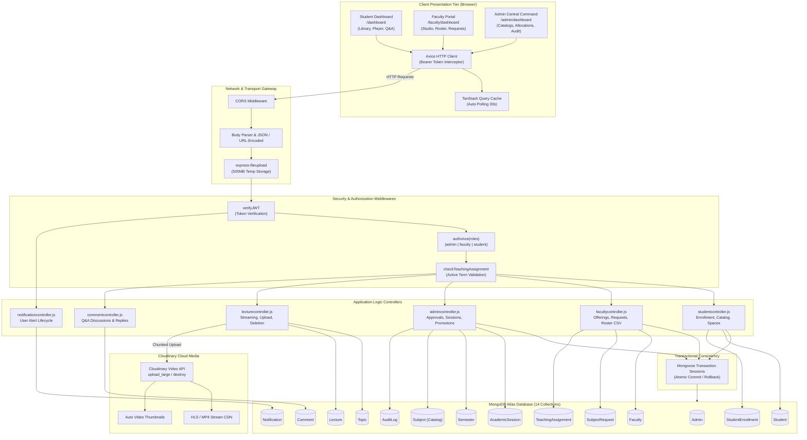
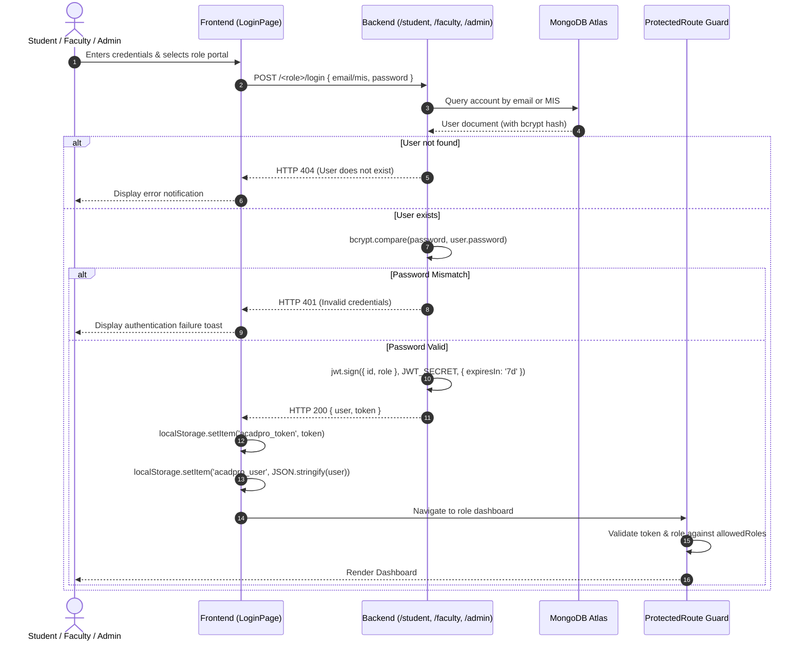
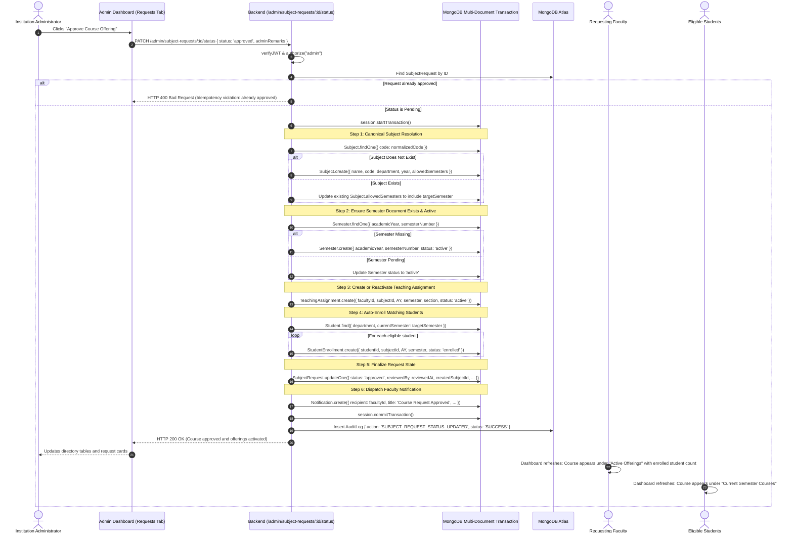
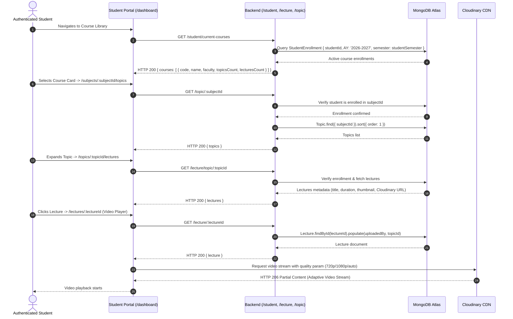
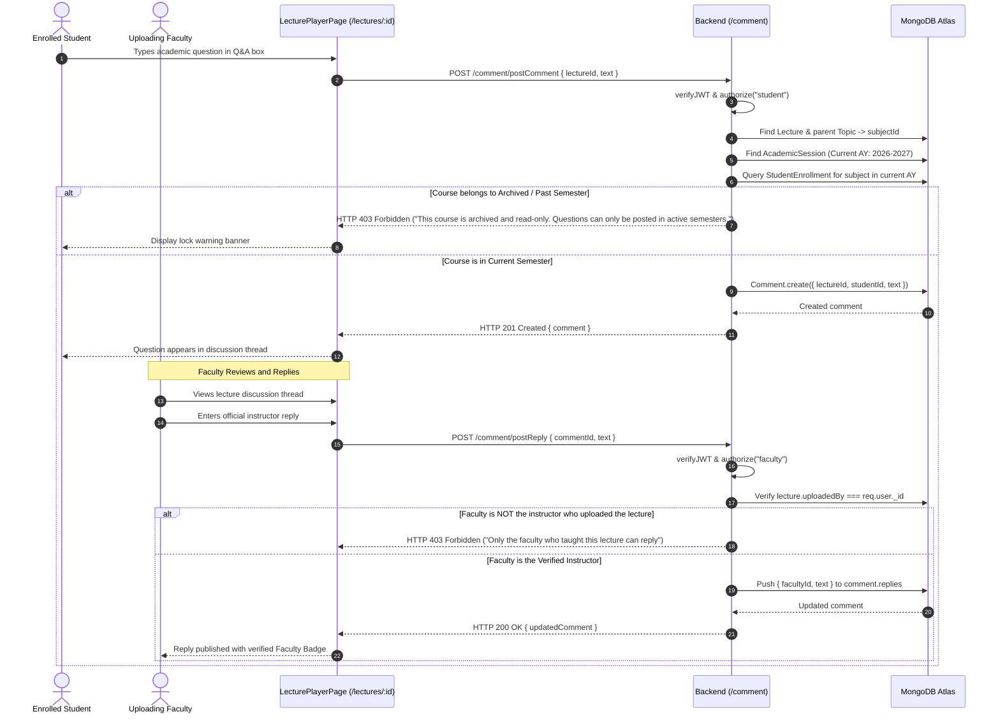
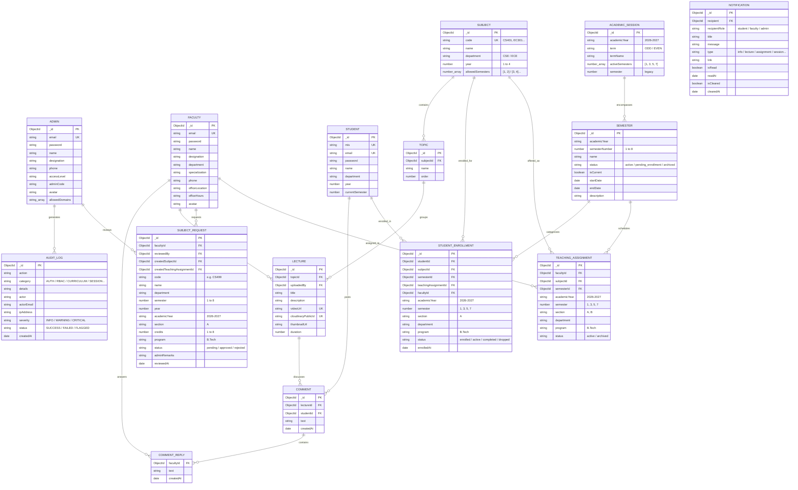
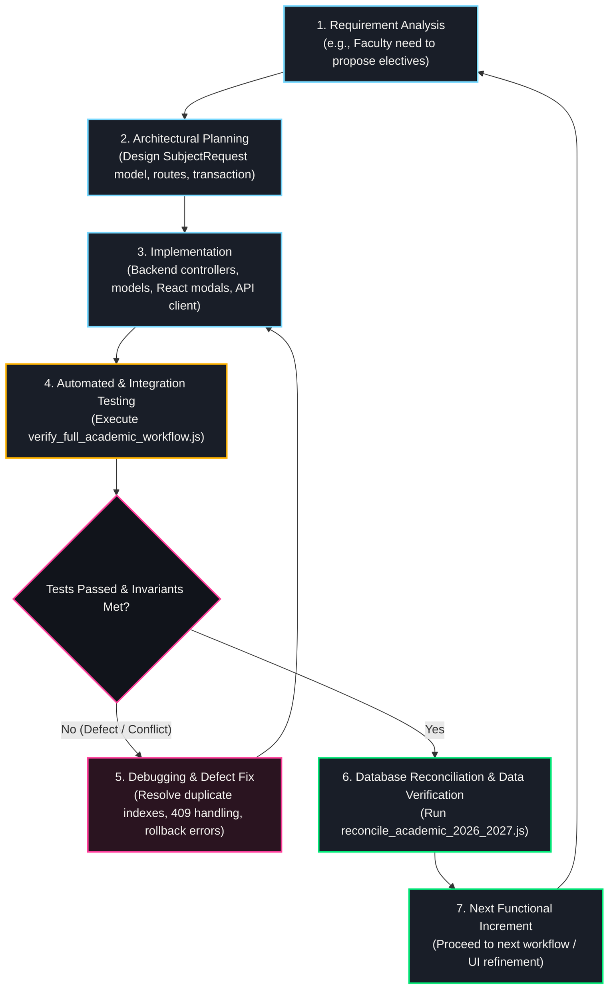
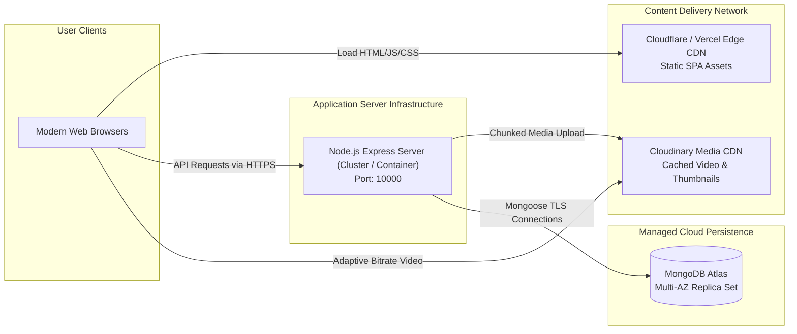

# AcadPro — System Architecture and SDLC

Technical Architecture Specification, Data Flows, and Software Development Life Cycle Analysis  
**System Version:** 1.0.0 (Project Final) • **Configured Academic Year:** 2026–2027 • **Active Term Semesters:** 1st, 3rd, 5th, 7th

---

## 1. Architectural Overview

AcadPro is an institutional academic lecture archive and digital learning platform designed for engineering colleges (specifically structured around the Indian Institute of Information Technology Pune curriculum ecosystem). The platform bridges classroom instruction and self-paced study by providing a structured hierarchy for lecture recordings: **Academic Session → Semester → Subject → Topic → Lecture → Discussion/Q&A**.

The system adopts a **decoupled, multi-tier client-server architecture** organized into clean separation of concerns:

```
┌────────────────────────────────────────────────────────────────────────┐
│                        PRESENTATION TIER                               │
│  React 19 SPA • Vite 8 • Tailwind / Modern Dark System • Framer Motion │
│   - Student Portal: Course Library, Video Theater, Discussion Board    │
│   - Faculty Portal: Course Allocations, Subject Requests, Studio, Roster│
│   - Admin Central: Semesters, Directory, Allocations, Security Audit   │
└───────────────────────────────────┬────────────────────────────────────┘
                                    │ HTTPS / REST (JSON) + Bearer JWT
                                    ▼
┌────────────────────────────────────────────────────────────────────────┐
│                        APPLICATION API TIER                            │
│           Node.js (ES Modules) • Express 5 REST Services               │
│   - Routes & Controllers: Modular domain-driven endpoints              │
│   - Authorization & Security: verifyJWT, authorize(roles)              │
│   - Domain Invariants: checkTeachingAssignment, past-semester locks    │
│   - Transaction Manager: Multi-document Mongoose atomic sessions       │
└──────────────────┬────────────────────────────────┬────────────────────┘
                   │ Mongoose ODM (Binary JSON)     │ HTTPS API / Multipart
                   ▼                                ▼
┌──────────────────────────────────────┐  ┌──────────────────────────────┐
│           PERSISTENCE TIER           │  │       MEDIA STORAGE TIER     │
│        MongoDB Atlas Cluster         │  │       Cloudinary CDN         │
│   14 Collections • Compound Indexes  │  │  Adaptive Chunked Video (HLS/│
│   ACID Transactions • Audit Trails   │  │  MP4), Dynamic Thumbnails    │
└──────────────────────────────────────┘  └──────────────────────────────┘
```

### 1.1 Architectural Layers and Responsibilities

1. **Presentation Layer (Frontend Single Page Application):**
   - Built on **React 19** bundled via **Vite 8**.
   - Client-side routing managed by **React Router DOM v7** with declarative role-based route guards (`ProtectedRoute`).
   - Server state caching, optimistic updates, and background synchronization powered by **TanStack React Query v5**.
   - HTTP transport abstraction using **Axios** with automatic `Bearer` token injection and unified error normalization (`getErrorMessage`).
   - UI styling implemented via custom CSS variables and utility classes supporting a modern glassmorphic dark theme (`#08090D`, `#11141B`, `#191E28`, cyan `#75D7FF`, pink `#FF3D9A`).

2. **Application / Business Logic Layer (Backend REST API):**
   - Built on **Node.js** running in ECMAScript Modules mode (`"type": "module"`) and **Express 5**.
   - Modular route definitions mounted under `/student`, `/faculty`, `/admin`, `/subject`, `/topic`, `/lecture`, `/comment`, and `/notifications`.
   - Business logic isolated in controller modules with asynchronous execution managed by `asyncHandler`.
   - Centralized error management via custom `ApiError` class and global `errorHandler` middleware.
   - Transactional business operations (e.g. course request approval, batch enrollment, student year promotion) wrapped in **Mongoose multi-document ACID transactions**.

3. **Authorization & Security Layer:**
   - Stateless authentication using **JSON Web Tokens (JWT)** signed with HMAC SHA-256 (`jsonwebtoken`).
   - Domain-level authentication verified via `verifyJWT`, populating `req.user` and decoupled `req.auth` claims.
   - Role-based access control (RBAC) enforced via `authorize("admin")`, `authorize("faculty")`, and `authorize("student")`.
   - Contextual academic permissions enforced via `checkTeachingAssignment`, ensuring faculty can only create topics and upload videos for officially assigned course offerings in active terms.
   - Student isolation rules preventing access to non-enrolled courses and enforcing read-only behavior on archived past-semester courses.

4. **Persistence Layer (Database):**
   - Hosted on **MongoDB Atlas** with object data modeling provided by **Mongoose 9**.
   - Encompasses **14 distinct collections** with strict schema definitions, compound uniqueness indexes, foreign key references, and pre-save password hashing hooks (`bcrypt`).

5. **External Media Storage Tier:**
   - Managed via the **Cloudinary Node.js SDK**.
   - Handles large video chunked streaming uploads (`cloudinary.uploader.upload_large` with 6MB chunks) directly from server temporary storage (`os.tmpdir()`), automatically cleaning up local disk files upon upload completion or failure.
   - Automatically derives video poster thumbnails and adaptive multi-bitrate delivery URLs (`q_auto`, responsive scaling).

---

## 2. System Architecture Diagram



---

## 3. Component and Module Architecture

```
                                  ┌───────────────────────────┐
                                  │   AcademicSession (AY)    │
                                  │   (e.g., "2026-2027")     │
                                  └─────────────┬─────────────┘
                                                │ governs
                                                ▼
         ┌──────────────────────────────┬──────────────────────────────┐
         │                              │                              │
         ▼                              ▼                              ▼
┌──────────────────┐          ┌───────────────────┐          ┌──────────────────┐
│  Semester Module │          │ Subject Catalog   │          │  Faculty Module  │
│  (Sem 1,3,5,7)   │          │ (CS401, EC301...) │          │  (Professors)    │
└────────┬─────────┘          └─────────┬─────────┘          └────────┬─────────┘
         │                              │                             │
         │                              ├─────────────────────────────┘
         │                              │
         │                              ▼
         │                   ┌─────────────────────────────┐
         │                   │ TeachingAssignment (Offering│
         │                   │  (Faculty + Subject + AY)   │
         │                   └──────────────┬──────────────┘
         │                                  │
         │         ┌────────────────────────┴────────────────────────┐
         │         │                                                 │
         ▼         ▼                                                 ▼
┌─────────────────────────────┐                           ┌────────────────────┐
│ StudentEnrollment Module    │                           │ Curriculum Space   │
│ (Student + Subject + Sem)   │                           │ (Topics & Lectures)│
└──────────────┬──────────────┘                           └──────────┬─────────┘
               │                                                     │
               ▼                                                     ▼
┌─────────────────────────────┐                           ┌────────────────────┐
│ Student Dashboard / Library │                           │ Cloudinary Media   │
│ (Active vs Archived Terms)  │                           │ & Q&A Discussions  │
└─────────────────────────────┘                           └────────────────────┘
```

### 3.1 Module Descriptions and Boundaries

| Module | Core Responsibility | Input Entities | Output / Side Effects |
|---|---|---|---|
| **Authentication & Profile** | User identification, token issuance, password updates, profile management | Credentials (email/MIS, password) | Signed JWT, auth state, profile record |
| **Academic Session & Semester** | College-wide academic schedule configuration (AY 2026–2027, odd semesters 1, 3, 5, 7) | Session parameters, semester records | `AcademicSession`, `Semester` state, term locks |
| **Course Addition Request** | Faculty proposal of new course offerings or curriculum additions | Code, Title, Dept, Semester, Section, Credits | `SubjectRequest` (pending), Admin notification, audit log |
| **Request Review & Transaction** | Atomic administrator review and curriculum materialization | Request ID, approval/rejection status, remarks | Canonical `Subject`, active `TeachingAssignment`, auto `StudentEnrollment`, faculty alert |
| **Teaching Assignment** | Faculty-to-course allocation for specific academic terms | Faculty ID, Subject ID, AY, Semester, Section | `TeachingAssignment`, faculty dashboard access, roster generation |
| **Student Enrollment & Promotion**| Enrollment allocation and academic batch progression | Student ID/batch, department, year, semester | `StudentEnrollment` (enrolled/completed), `Student` year update |
| **Curriculum & Lecture Studio**| Topic structuring, video upload, encoding, thumbnail extraction | Topic parameters, MP4/MKV video files | `Topic`, `Lecture`, Cloudinary assets, video player stream |
| **Discussion & Moderation** | Student inquiries and faculty replies on video lectures | Lecture ID, student text, faculty reply text | `Comment` tree, read-only past semester enforcement |
| **Notification Engine** | In-app notification delivery, read tracking, and dismissal | Triggering event, recipient ID, role, alert payload| `Notification` record, unread counter badge |
| **Audit & Security Logging** | Immutable tracking of institutional and security-sensitive events | Actor, IP address, action, severity, details | `AuditLog` entry, security timeline view |

---

## 4. End-to-End Data Flow Diagrams

### 4.1 User Authentication and Role-Based Access Control



### 4.2 Faculty Subject Request Workflow

```mermaid
sequenceDiagram
    autonumber
    actor Faculty as Faculty Member
    participant UI as Faculty Dashboard
    participant API as Backend (/faculty/request-subject)
    participant DB as MongoDB Atlas
    actor Admin as Institution Administrator

    Faculty->>UI: Clicks "Request Course Offering"
    UI->>UI: Opens modal; selects AY (2026-2027), Semester (1, 3, 5, 7), Dept, Code, Title
    Faculty->>UI: Submits request form
    UI->>API: POST /faculty/request-subject { code, name, department, semester, section }
    
    API->>API: verifyJWT & authorize("faculty")
    API->>DB: Check if Faculty is already assigned to this offering
    alt Already Assigned
        API-->>UI: HTTP 409 Conflict (Already actively assigned to teach this course)
        UI-->>Faculty: Display warning toast
    else Not Assigned
        API->>DB: Check if pending SubjectRequest exists for code + AY + semester + section
        alt Pending Duplicate Exists
            API-->>UI: HTTP 409 Conflict (Request already pending administrator review)
            UI-->>Faculty: Display duplicate request warning
        else Valid Request
            API->>DB: Insert SubjectRequest { status: 'pending', facultyId, ... }
            API->>DB: Query all active Admins
            API->>DB: Bulk insert Notification for Admins ("Course Request: CSxxx")
            API->>DB: Insert AuditLog { action: 'SUBJECT_REQUESTED', category: 'CURRICULUM' }
            API-->>UI: HTTP 201 Created { subjectRequest }
            UI->>UI: Optimistically update "Course Requests" tab (Pending status badge)
            Admin->>Admin: Sees real-time unread notification badge in TopHeader
        end
    end
```

### 4.3 Subject Request Approval, Allocation, and Auto-Enrollment (Atomic Transaction)



### 4.4 Student Course Discovery and Video Streaming Flow



### 4.5 Discussion & Q&A Workflow (Active vs. Archived Past Semester)



---

## 5. Database Architecture and Entity-Relationship Model

AcadPro uses a schema-enforced document store running on MongoDB Atlas.

### 5.1 Complete Entity-Relationship (ER) Diagram



### 5.2 Key Data Integrity Constraints and Indexes

| Collection | Compound / Unique Index | Integrity Purpose |
|---|---|---|
| `Subject` | `{ code: 1 }` (unique) | Guarantees course code uniqueness across the college catalog. Prevents duplicate syllabus records. |
| `Semester` | `{ academicYear: 1, semesterNumber: 1 }` (unique) | Prevents redundant semester terms within any given academic year. |
| `TeachingAssignment` | `{ facultyId: 1, subjectId: 1, academicYear: 1, semester: 1, section: 1 }` (unique) | Prevents allocating the same faculty member to the same course section more than once per term. |
| `StudentEnrollment` | `{ studentId: 1, subjectId: 1, academicYear: 1, semester: 1 }` (unique) | Prevents duplicate student enrollments in the same subject during an academic session. |
| `SubjectRequest` | `{ code: 1, academicYear: 1, semester: 1, section: 1, status: 1 }` | Prevents redundant pending requests for the same course offering while one is under review. |
| `Notification` | `{ recipient: 1, isCleared: 1, createdAt: -1 }` | Optimizes high-frequency polling for unread user alerts and suppresses dismissed items. |
| `Lecture` | `{ cloudinaryPublicId: 1 }` (unique), `{ videoUrl: 1 }` (unique) | Eliminates phantom media mappings and guarantees 1-to-1 correspondence with Cloudinary assets. |

---

## 6. Security Architecture and Trust Boundaries

AcadPro implements defense-in-depth principles across all architectural tiers:

```
[ UNTRUSTED PUBLIC CLIENTS ]
             │
             ▼
[ REVERSE PROXY / CORS BOUNDARY ] ── Strict origin validation
             │
             ▼
[ AUTHENTICATION GATEWAY ] ──────── Verify HMAC SHA-256 JWT, check expiry (7d)
             │
             ▼
[ RBAC AUTHORIZATION GATEWAY ] ──── Validate role claims against endpoint whitelist
             │
             ▼
[ DOMAIN INVARIANT MIDDLEWARE ] ─── checkTeachingAssignment, Enrollment Verification
             │
             ▼
[ CONTROLLER LOGIC ] ────────────── User ID derived from req.user (Never from body)
             │
             ▼
[ PERSISTENCE TIER ] ────────────── MongoDB Atlas TLS, Pre-save bcrypt salts
```

### 6.1 Authentication Mechanism
- Client passes the JWT in the standard HTTP header: `Authorization: Bearer <token>`.
- Tokens are issued upon successful credential verification with a standard expiration of 7 days (`expiresIn: "7d"`).
- Passwords for `Admin` and `Faculty` are salted and hashed automatically before persistence via Mongoose pre-save hooks (`bcrypt.genSalt(10)`).
- `Student` passwords are explicitly hashed during signup in `studentcontroller.js`.
- Passwords are never returned in API payloads (`.select("-password")`).

### 6.2 Trust Boundary Enforcement & Parameter Tampering Prevention
- **Identity Derivation:** The authenticated identity (`req.user._id`) is extracted strictly from the verified JWT payload. Client attempts to pass foreign `userId`, `studentId`, or `facultyId` in request bodies are ignored.
- **Faculty Uploader Invariant:** Only the faculty member whose ID matches `lecture.uploadedBy` can delete the lecture or post official replies to comments on that lecture.
- **Active Term Gating:** Faculty cannot create topics or upload videos unless `checkTeachingAssignment` confirms an active teaching assignment matching the subject and the active semesters configured in `AcademicSession`.
- **Institutional Domain Whitelist:** Student self-registration is strictly gated to the college email domain `@iiitp.ac.in`. Public domain registrations (e.g. `@gmail.com`) are rejected with HTTP 403.
- **Administrative Account Protection:** Faculty and Admin self-signup routes are intentionally omitted from the codebase. The initial Admin is seeded manually directly in the database. Subsequent faculty accounts are created only by authenticated administrators.

### 6.3 Identified Architectural Security Considerations
- **Storage of Tokens in LocalStorage:** Storing tokens in client `localStorage` carries potential vulnerability to Cross-Site Scripting (XSS). An identified architectural enhancement is migrating session tokens to `HttpOnly`, `SameSite=Strict`, `Secure` cookies.
- **Rate Limiting:** Login endpoints currently do not enforce IP-based rate limiting. A recommended enhancement is integrating `express-rate-limit` to mitigate brute-force password guessing.

---

## 7. Architectural Design Decisions and Trade-Offs

| Decision | Selected Approach | Alternative Considered | Rationale & Trade-Off |
|---|---|---|---|
| **System Architecture** | Decoupled Client-Server (SPA + Express REST) | Monolithic Server-Side Rendered (SSR) / Next.js | Provides clean boundary between frontend UI and backend API. Enables independent scaling and rich desktop-like UX. Trade-off: requires managing client-side auth state and CORS. |
| **Media Pipeline** | Cloudinary CDN with Chunked Temp-file Upload | Self-hosted MinIO / AWS S3 with FFmpeg transcoding worker | Offloads video transcoding, thumbnail extraction, and adaptive bitrate delivery without maintaining heavy background transcode worker infrastructure. Trade-off: external dependency on Cloudinary API limits. |
| **Course Offering Decoupling** | Canonical `Subject` catalog decoupled from `TeachingAssignment` | Embedded faculty/term arrays directly inside `Subject` document | Separates syllabus definition (course code, name, credits) from offering logistics (faculty, term, section). Allows the same course to be taught across multiple semesters by different professors without schema duplication. |
| **Enrollment Allocation** | Explicit `StudentEnrollment` documents | Computing enrollments dynamically from Student year/dept on each request | Explicit records enable historic roster preservation, student-specific course status tracking (`enrolled`, `completed`), and performant roster queries. Trade-off: requires transactional sync during promotion and request approvals. |
| **Notification Engine** | Polling via React Query (30s interval) | Full-duplex WebSockets (Socket.IO) | Minimizes server state management, avoids sticky session issues in serverless/cluster setups, and aligns well with read/dismiss lifecycle. Trade-off: notifications have an average propagation latency of 15 seconds. |
| **Database Concurrency** | MongoDB Multi-Document ACID Transactions | Two-Phase Commits / Application-level saga | Guarantees that course creation, offering activation, and student enrollment either all succeed or all fail together. Eliminates partial phantom records during request approval. |

---

## 8. Software Development Life Cycle (SDLC) Model

### 8.1 Empirical Methodology: Agile Iterative and Incremental Development

The development history of AcadPro demonstrates that the system was built using an **Agile SDLC** adhering to an **Iterative and Incremental Development approach**.

Rather than attempting to define an exhaustive, immutable blueprint upfront or implementing formal rigid ceremonies, the project evolved through successive working versions driven by hands-on verification, code refactoring, and integration testing:

```
        ┌────────────────────────────────────────────────────────┐
        │            AGILE ITERATIVE & INCREMENTAL SDLC          │
        └───────────────────────────┬────────────────────────────┘
                                    │
    ┌───────────────────────────────┴───────────────────────────────┐
    ▼                                                               ▼
INCREMENTAL (Feature Growth)                        ITERATIVE (Quality Refinement)
- Iteration 1: Core Lecture Archive                 - Schema refactoring (9 to 14 models)
- Iteration 2: Stitch UI Integration                - Term migration (2025-2026 to 2026-2027)
- Iteration 3: Multi-Semester Allocation            - Semester label standardization (1st, 3rd, 5th, 7th)
- Iteration 4: Notifications & Audit System         - Transactional approval synchronization
- Iteration 5: Subject Request Workflow             - Cloudinary chunked streaming resilience
```

#### Core Concepts as Manifested in AcadPro:
1. **Agile (Adaptive & Feedback-Driven):**
   - Requirements were refined based on practical deployment observations (e.g. recognizing that faculty needed a formal workflow to propose elective courses, leading to the creation of `SubjectRequest`).
   - Changes were made in response to test outputs and schema reconciliation needs rather than rigid contract specifications.
2. **Iterative Development (Revisiting & Refining):**
   - The academic configuration was repeatedly revisited: starting from a simple year-based model (`Subject.year <= Student.year`), evolving through semester numbers, and ultimately refined into concurrent active terms (Autumn Term: Semesters 1, 3, 5, 7) for AY 2026–2027.
   - The UI was iterated from basic tables to Stitch-designed glassmorphic dashboards with animated transitions.
3. **Incremental Development (Successive Functional Delivery):**
   - The application grew by adding distinct functional increments:
     - *Increment 1:* Basic student/faculty auth and lecture upload.
     - *Increment 2:* Admin curriculum management and manual teaching assignment.
     - *Increment 3:* Multi-semester enrollment tracking and student promotion.
     - *Increment 4:* In-app notification center and security audit logging.
     - *Increment 5:* Faculty course addition requests with atomic admin approvals and roster export.
4. **Continuous Regression Testing:**
   - Dedicated verification test suites (`Backend/scripts/verify_full_academic_workflow.js`, `test_subject_request_flow.js`) were engineered to validate each iteration, verifying that additions did not break existing authentication, authorization, or curriculum flows.

### 8.2 Comparison with Alternative SDLC Models

| Attribute | Agile Iterative & Incremental (AcadPro) | Waterfall Model | Spiral Model |
|---|---|---|---|
| **Requirement Flexibility** | High; accommodates evolving academic rules | Low; requirements frozen in phase 1 | Moderate; adjusted after each risk cycle |
| **Delivery Model** | Working software delivered at each iteration | Single monolithic delivery at project end | Incremental prototypes following risk analysis |
| **Testing Integration** | Continuous testing after every feature addition | Performed exclusively after implementation | Performed per cycle, focused on risk |
| **Suitability for AcadPro** | **Highly Suitable:** Modules (courses, lectures, requests) have deep interdependencies requiring frequent validation | **Unsuitable:** Academic semester requirements and schema invariants evolved significantly during build | **Less Representative:** AcadPro focused on feature functionality and UI rather than formal risk mitigation cycles |

> [!NOTE]
> **Process Accuracy Note:** The team did not follow formal Scrum ceremonies (daily standups, sprint point estimations, or burn-down charts). Describing the workflow as Agile reflects its adaptive, iterative, test-driven nature rather than adherence to formal commercial frameworks.

---

## 9. AcadPro Development and Feedback Cycle

The recurring development cycle followed during the evolution of the AcadPro codebase is visualized below:



### 9.1 Cross-Module Ripple Effects and Regression Testing
In AcadPro, changes to one subsystem directly impact dependent subsystems:
- **Modifying `SubjectRequest` Status to Approved:** Automatically invokes the `Subject` catalog, `Semester` status, `TeachingAssignment` allocation, `StudentEnrollment` batch generation, `Notification` dispatch, and `AuditLog` creation. If any step fails, an unhandled error could leave phantom courses or enroll students in non-existent offerings.
- **Student Year Promotion:** Progresses students from Year 1 Sem 1 to Year 2 Sem 3. This triggers a status change of previous enrollments to `completed`, removes students from active course rosters, and enrolls them into new semester courses.
- **Why Automated Regression Scripts Matter:** The 14-test suite (`verify_full_academic_workflow.js`) executes these cross-module scenarios in sequence, confirming that atomic transactions roll back cleanly upon simulated failure and that data integrity is maintained across all 14 collections.

---

## 10. Quality Assurance and Testing Architecture

### 10.1 Verified Test Suites in Codebase

The repository contains automated verification scripts designed to validate the system end-to-end:

| Script Path | Purpose | Execution Status |
|---|---|---|
| `Backend/scripts/verify_full_academic_workflow.js` | Comprehensive 14-point test suite covering requests, transactional approvals, faculty dashboard visibility, catalog integrity, eligible vs. ineligible student access, idempotency, rejections, promotions, roster retention, and simulated rollback. | **14 / 14 Tests Passing** |
| `Backend/scripts/test_subject_request_flow.js` | 10-point test suite specifically testing faculty course proposal, instant admin notifications, directory requests tab visibility, approval confirmation alerts, and duplicate request prevention. | **10 / 10 Tests Passing** |
| `Backend/scripts/inspect_db.js` | Database inspection script that queries live collections, verifies active academic sessions (`2026–2027`), active semesters (`[1, 3, 5, 7]`), and enrollment counts. | **Executed & Verified** |
| `Backend/scripts/reconcile_academic_2026_2027.js` | Data migration and integrity repair script reconciling existing student placements, course allowed semesters, and active teaching assignments. | **Executed & Verified** |

### 10.2 Representative Verification Matrix

```
┌────────────────────────────────────────────────────────────────────────┐
│               ACADPRO VERIFIED TEST MATRIX (14 SCENARIOS)               │
├──────┬────────────────────────────────────────────┬───────────┬────────┤
│ Test │ Scenario Description                       │ Expected  │ Result │
├──────┼────────────────────────────────────────────┼───────────┼────────┤
│ A    │ Faculty submits course addition request    │ HTTP 201  │ PASS   │
│ B    │ Admin transactionally approves request     │ HTTP 200  │ PASS   │
│ C    │ Faculty dashboard displays new offering    │ Found     │ PASS   │
│ D    │ Canonical subject catalog has no duplicate │ Count = 1 │ PASS   │
│ E    │ Eligible student enrolled; Ineligible blocked│ Restricted│ PASS   │
│ F    │ Duplicate course offering request rejected │ HTTP 409  │ PASS   │
│ G    │ Repeated approval on approved request      │ HTTP 400  │ PASS   │
│ H    │ Rejection updates status & remarks cleanly │ Rejected  │ PASS   │
│ I    │ Student promotion creates new enrollments  │ Promoted  │ PASS   │
│ J    │ Old semester enrollment retained completed │ Preserved │ PASS   │
│ K    │ Faculty office hours & bio persisted       │ Persisted │ PASS   │
│ L    │ Non-admin role blocked from approval route │ HTTP 403  │ PASS   │
│ M    │ Transaction failure triggers clean rollback│ 0 Phantoms│ PASS   │
│ N    │ Notification lifecycle & audit trail active│ Logged    │ PASS   │
└──────┴────────────────────────────────────────────┴───────────┴────────┘
```

---

## 11. Deployment Architecture

### 11.1 Local Development Environment

```
[ Developer Workstation ]
  │
  ├── Frontend Server: Vite Dev Server (http://localhost:5173)
  │    - Hot Module Replacement (HMR)
  │    - Proxies/Dispatches API requests to http://localhost:10000
  │
  ├── Backend Server: Node.js / Nodemon (http://localhost:10000)
  │    - Loads Backend/.env
  │    - Listens on PORT 10000 (fallback 5000)
  │
  ├── Remote Services:
  │    - MongoDB Atlas Replica Set (via secure MONGODB URI with TLS)
  │    - Cloudinary Cloud Storage (via HTTPS API credentials)
```

### 11.2 Production Deployment Architecture



### 11.3 Production Configuration Checklist
- `NODE_ENV=production`
- Strict CORS configuration whitelisting only the production frontend origin.
- Sensitive environment variables (`MONGO_DB_URL`, `JWT_SECRET`, `API_SECRET`) injected securely via secret managers or deployment dashboard env settings.
- Build artifact generated via `npm run build` inside `Frontend/`, producing optimized static assets in `Frontend/dist/`.

---

## 12. Architectural Limitations and Proposed Improvements

### 12.1 Existing Architectural Limitations
1. **Notification Delivery Latency:** Notifications rely on 30-second client-side polling. Real-time instant delivery would benefit from a persistent WebSocket or Server-Sent Events (SSE) channel.
2. **Synchronous Video Upload Processing:** Video upload to Cloudinary occurs during the HTTP request lifecycle. For very large video files (approaching 500MB), slow network links can cause HTTP connection timeouts.
3. **Client-side Session Storage:** JWTs are stored in browser `localStorage`, which is accessible to JavaScript and thus theoretically vulnerable to XSS.
4. **Course Request Scope:** Currently, a course request automatically enrolls all students matching the department and semester. Elective courses where students should self-enroll are not yet modeled separately from mandatory core courses.

### 12.2 Proposed Future Architecture Roadmap
- **Asynchronous Background Ingestion Queue:** Introduce BullMQ or Redis-backed task workers to process video uploads asynchronously, returning an immediate job ID to the client.
- **WebSocket Gateway:** Implement a lightweight WebSocket server for instantaneous push notifications and live discussion updates.
- **HttpOnly Cookie Authentication:** Transition authentication from Authorization headers to signed `HttpOnly`, `SameSite=Strict` cookies.
- **Elective Selection Module:** Expand `StudentEnrollment` to support elective bidding or self-enrollment workflows alongside admin-driven core allocations.
